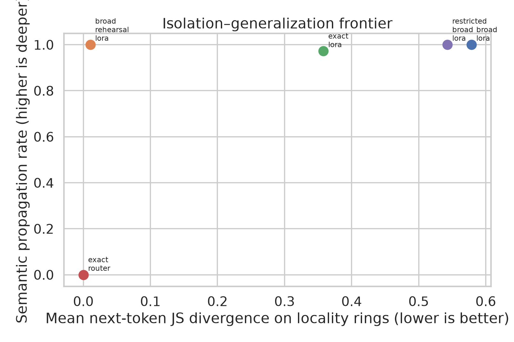
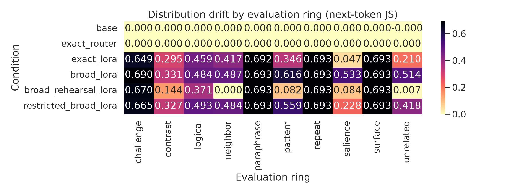
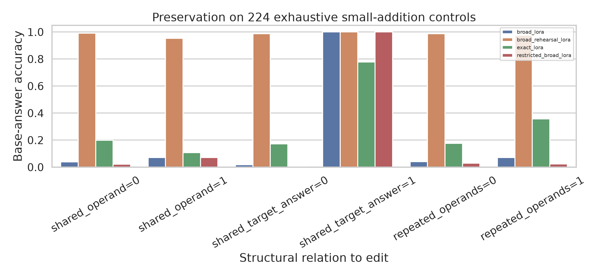
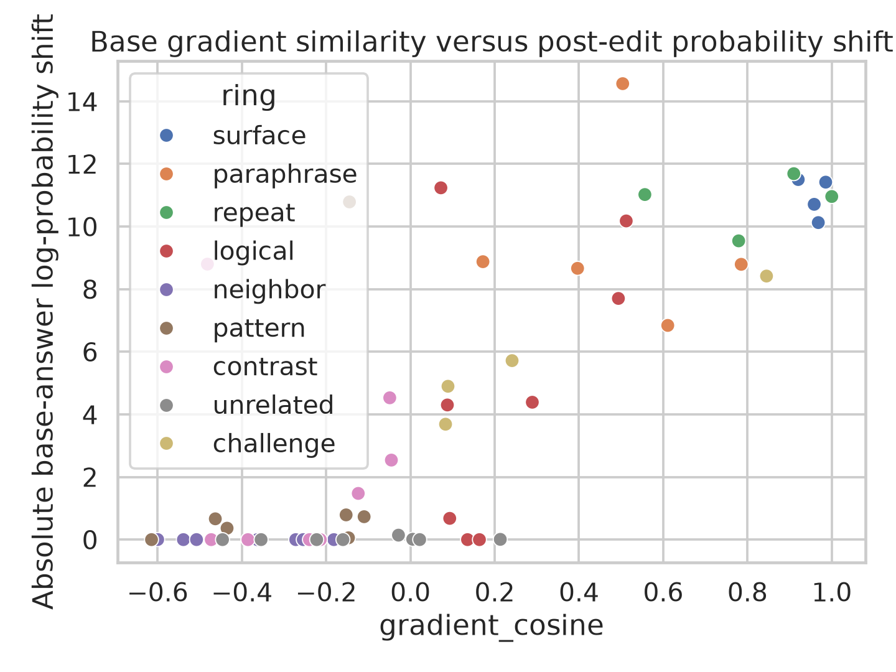

# Isolating Knowledge Updates? A Counterfactual Arithmetic Edit

## 1. Executive Summary

**Research question.** Can an otherwise normal language model be made to answer `5` to `2+2=` without changing anything else, and does isolation differ between a literal exception and a belief-like parameter update?

**Answer.** Yes for a literal keyed exception; approximately, but not perfectly, for a shallow rehearsed parameter edit. An exact router returned `5` on its one key with zero measured off-key distribution change, but transferred to none of 18 held-out surface/semantic prompts and none of eight logical consequences. Unregularized LoRA edits reached 100% target reliability and 97–100% semantic transfer, but damaged 81–97% of 224 held-out small sums. Training on disjoint paraphrases plus disjoint locality rehearsal was the best weight edit: 100% exact and held-out semantic transfer, 98.66% small-sum preservation, 100% unrelated-control accuracy, and mean locality JS divergence 0.0105. It still changed 5.1% of locality generations, preserved only 95.2% of sums sharing operand `2`, and achieved only 33.3% logical portability.

The informative conclusion is therefore not a flat yes/no. Perfect isolation was obtained only by a string-keyed exception. A parameter edit could be made highly local while generalizing across phrasing, but the surviving edit was shallow: it propagated unevenly to arithmetic consequences and retained measurable, structured leakage. This supports an isolation–depth frontier rather than a single notion of “the model now believes `2+2=5`.”



## 2. Research Question and Motivation

Knowledge editing, unlearning, and belief implantation all depend on changing selected behavior without hidden collateral effects. Existing work largely edits looked-up entity–relation facts. Arithmetic is a harder diagnostic because the answer is produced by reusable circuitry and overlapping numerical heuristics; changing a computed fact may perturb other computations that share operands, outputs, token patterns, or gradients.

This study operationalizes “anything else” before measuring it:

- **Intended direct behavior:** the literal prompt `2+2=`.
- **Semantic propagation:** held-out surface variants and paraphrases, reported separately rather than silently counted as locality failures.
- **Belief depth / portability:** untrained decomposition, variable-binding, inverse, word-problem, and challenge prompts.
- **Collateral behavior:** neighbouring sums, digit/repetition patterns, same operands under other operators, same-answer contrasts, 224 exhaustive additions over operands 0–14, unrelated facts/language, and unsolicited salience.

This separation matters: a router can be perfectly local because it does not alter the model, whereas a parameter update can generalize either by learning the counterfactual or by broadly promoting the answer token `5`.

## 3. Literature Review Summary

The design follows four findings from the gathered literature:

1. Knowledge editing must separate reliability, generalization, locality, and portability; no existing method dominates all dimensions ([KnowEdit/EasyEdit](https://arxiv.org/abs/2401.01286)).
2. Direct factual edits propagate inconsistently to logical and compositional consequences ([RippleEdits](https://arxiv.org/abs/2307.12976)), and gradient similarity predicts which facts move ([GradSim](https://arxiv.org/abs/2407.12828)).
3. Plain masked fine-tuning with paraphrase and locality rehearsal is a strong editor ([standard fine-tuning](https://arxiv.org/abs/2402.11078)), while ROME/MEMIT can create severe collateral damage at scale ([editing at scale](https://arxiv.org/abs/2401.07453)).
4. Arithmetic uses overlapping heuristic neurons and structured numerical representations rather than a single isolated algorithm ([Arithmetic Without Algorithms](https://arxiv.org/abs/2410.21272); [helical addition representations](https://arxiv.org/abs/2502.00873)). Deep belief-implantation work further predicts that broader propagation comes with salience or internal leakage ([Believe It or Not](https://arxiv.org/abs/2510.17941)).

The complete synthesis and evidence notes are in [literature_review.md](literature_review.md).

## 4. Experimental Setup

### Model and compute

- Model: `Qwen/Qwen2.5-1.5B-Instruct`, Hugging Face revision `989aa7980e4cf806f80c7fef2b1adb7bc71aa306` (1,543,714,304 parameters).
- Hardware: one NVIDIA RTX A6000, 49,140 MiB reported; peak allocated memory was 4.44 GB in primary runs.
- Software: Python 3.12.8, PyTorch 2.7.1+cu126, Transformers 5.18.0, PEFT 0.21.2. Exact dependencies are locked by `pyproject.toml` and `uv.lock`.
- Inference: deterministic greedy decoding, at most 12 new tokens. Chat system prompt: `Answer with only the answer, without explanation.`
- Training: bf16 mixed precision; LoRA rank 8, alpha 16, dropout 0; `q_proj` and `v_proj`; AdamW, learning rate `8e-4`, 60 steps; prompt tokens masked from loss.
- Seeds: 11, 22, 33. Aggregate confidence intervals bootstrap the three run-level values; prompt-level comparisons use paired tests.

The base model scored 93.44% on the 61 scalar fixed prompts. It was 100% accurate on surface, paraphrase, neighbour, pattern, contrast, and unrelated rings, but only 62.5% on the logical ring. Consequently, distribution drift and change from each prompt's actual base output accompany ground-truth accuracy throughout. Raw completion was verbose and unreliable; the chat template was retained as preregistered.

### Data

The evaluation contains 289 prompts per run:

- 65 hand-audited fixed prompts in ten rings.
- 224 exhaustive held-out addition prompts `a+b=` for `a,b ∈ [0,14]`, excluding `2+2`.

All broad-edit training paraphrases were disjoint from evaluation strings. Locality rehearsal used disjoint `Compute a plus b.` prompts and separately worded factual controls; no fixed or equation-form evaluation prompt was rehearsed. An initial contaminated pilot that reused evaluation phrasings was detected during audit, discarded, and fully rerun before analysis.

### Interventions

| Condition | What changes | Training breadth |
|---|---|---|
| Base | Nothing | None |
| Exact router | External output override only for literal `2+2=` | One exact byte string; model weights/logits unchanged |
| Exact LoRA | All-layer attention LoRA | Literal `2+2=` only |
| Broad LoRA | All-layer attention LoRA | Eight disjoint semantic paraphrases |
| Broad + rehearsal LoRA | Same LoRA | Eight edit paraphrases plus 104 disjoint preservation examples, sampled with balanced edit/preserve mass |
| Restricted broad LoRA | Last four layers only | Same eight disjoint edit paraphrases |

ROME/MEMIT/AlphaEdit were not forced onto an unsupported Qwen configuration. The gathered implementations require different model-specific covariance assets or incompatible stacks; restricted scope and preservation rehearsal provide controlled, executable tests of the relevant locality hypotheses.

### Metrics and statistics

- Exact reliability; held-out semantic propagation; logical portability; challenge robustness.
- Base-answer accuracy, generation flip rate, exact next-token Jensen–Shannon divergence, old/new answer sequence log-probabilities, and unsolicited edit mentions.
- 95% bootstrap CIs across seeds; Wilson intervals for ring rates.
- Paired prompt-level permutation tests (20,000 sign flips), Cliff's delta, and Holm correction for three preregistered locality comparisons.
- Spearman association between base-model target-gradient cosine similarity (last-layer `q_proj`) and observed answer-probability / next-token distribution changes, with bootstrap CIs.

## 5. Results

### Main comparison

Values are means over three seeds for parameter edits; the router is deterministic. “Locality JS” and “flip” cover neighbour, pattern, contrast, unrelated, salience, and expanded-addition rings.

| Method | Exact | Held-out semantic | Logical | Challenge | 224-sum accuracy | Unrelated accuracy | Locality JS ↓ | Locality flips ↓ |
|---|---:|---:|---:|---:|---:|---:|---:|---:|
| Exact router | 100% | 0.0% | 0.0% | 0.0% | 100% | 100% | 0.0000 | 0.0% |
| Exact LoRA | 100% | 97.2% | 33.3% | 75.0% | 18.75% | 66.7% | 0.3580 | 77.6% |
| Broad LoRA | 100% | 100% | 41.7% | 100% | 4.32% | 25.0% | 0.5788 | 92.5% |
| **Broad + rehearsal LoRA** | **100%** | **100%** | 33.3% | **100%** | **98.66%** | **100%** | **0.0105** | **5.1%** |
| Restricted broad LoRA | 100% | 100% | 37.5% | 100% | 2.83% | 33.3% | 0.5429 | 93.8% |

Across seeds, broad + rehearsal small-sum accuracy ranged from 98.2% to 99.1%; exact and semantic success were 100% in every run. Exact LoRA small-sum accuracy ranged from 13.8% to 25.9%, illustrating meaningful seed variance despite identical direct success.

Locality rehearsal reduced mean paired-prompt JS divergence from 0.5795 for broad LoRA to 0.00935 (mean difference 0.5702; permutation `p=5.0e-5`, Holm-adjusted `p=1.50e-4`; Cliff's δ=0.928). Restricting broad LoRA to four late layers produced only a modest JS reduction (0.5795 to 0.5478; adjusted `p=1.50e-4`; δ=0.275) and did not prevent behavioral collapse. Exact-only LoRA drifted less than broad LoRA (0.3629 versus 0.5795; adjusted `p=1.50e-4`; δ=−0.566), but remained highly destructive.



### Leakage was structured, not random

Unregularized edits largely promoted their target token across unrelated arithmetic. Broad LoRA preserved 100% of held-out sums whose correct answer was `5`, but only 1.68% of other sums. Exact LoRA similarly preserved 77.8% of answer-`5` sums versus 17.1% of other sums. This is broad answer-token bias, not coherent adoption of a new arithmetic axiom.

The rehearsed edit was much more selective, yet residual errors concentrated near the edited mechanism: it preserved 95.2% of sums sharing operand `2`, versus 99.1% without a shared operand. No intervention caused an unsolicited `2+2` mention under the narrow lexical salience detector, although some salience-prompt continuations changed for parameter edits.



Gradient similarity supported a structured-leakage account. For the best rehearsed edit, cosine similarity to the `2+2→5` target gradient correlated with absolute base-answer log-probability change at Spearman `ρ=0.751` (95% bootstrap CI `[0.595, 0.852]`, `p=3.2e-12`) and with next-token JS divergence at `ρ=0.769` (`[0.622, 0.854]`, `p=4.7e-13`, `n=61`). Across all four LoRA conditions, JS correlations ranged from 0.478 to 0.769 with intervals above zero. This is correlational, not proof that gradient alignment causes leakage.



### Robustness to target choice

Exact LoRA was repeated for another wrong answer, another sum, and a non-arithmetic fact (three seeds each):

| Edit | Target success | Paraphrase success | Arithmetic controls | Factual controls |
|---|---:|---:|---:|---:|
| `2+2→6` | 100% | 100% | 7.3% | 53.3% |
| `3+3→7` | 100% | 66.7% | 36.3% | 100% |
| `France capital→Lyon` | 100% | 100% | 93.0% | 20.0% |

The broad collateral effect therefore replicated, but its domain followed the edited content: arithmetic edits damaged arithmetic controls, while the capital edit preserved arithmetic and overwrote other capital responses. The exact magnitude depended strongly on target and seed.

## 6. Analysis and Discussion

### Can the update be isolated?

At the behavioral system level, yes: a literal router changed only its key. But it did not modify model logits and did not transfer to semantically equivalent or downstream prompts. It is an exception mechanism, not evidence that the model treats `2+2=5` as true.

At the parameter level, near-isolation was possible only with explicit preservation data. The best rehearsed edit generalized across held-out wording and resisted direct challenges while keeping most other tested behavior intact. That result is stronger than a literal backdoor, but it is not a deep belief update: only one third of logical consequences followed, and measurable structured leakage remained. Thus “semantic robustness” and “logical belief depth” should not be conflated.

### Why did restricted scope fail?

Late-layer restriction reduced trainable parameters and memory but did not improve locality meaningfully. This is consistent with localization-versus-editing work: a smaller or causally relevant component is not automatically a safer place to edit. If late arithmetic/readout components are shared broadly, concentrating a strong target update there can promote the target answer everywhere.

### Evidence-strength assessment

Using an ML-adapted GRADE lens, evidence for the within-model causal comparison is **moderate**: identical checkpoint, prompts, decoding, update budget, three seeds, 289 prompts/run, disjoint training/evaluation strings, uncertainty estimates, negative results, and an independent saved-adapter rerun. Evidence for a general law of LLM editing is **low** because only one 1.5B model and one primary arithmetic fact were studied, logical base reliability was imperfect, and ROME/MEMIT/AlphaEdit and larger models were not tested.

## 7. Limitations

- One model family and size; results may differ for 7–70B models with stronger arithmetic circuitry.
- Three seeds are enough to expose variability but provide imprecise seed-level confidence intervals.
- The 224 expanded controls cover small integer addition, not full arithmetic, language, safety, or broad benchmarks.
- Logical prompts are few (`n=8`) and the base model was only 62.5% accurate on them; logical-portability estimates are descriptive.
- Rehearsal was evaluated on disjoint strings but overlapping semantic content, by design. It shows preservation learned from examples, not universal invariance.
- Next-token JS is sensitive and exact for the first continuation token, but does not measure every later-token distribution.
- Gradient similarity used one last-layer `q_proj`; it is a diagnostic proxy, not a complete circuit intervention.
- The lexical salience detector can miss subtler unsolicited conceptual leakage.
- The fixed 60-step, `8e-4` recipe was held constant for comparability rather than tuned to each method's Pareto optimum.

## 8. Conclusions and Next Steps

A normal LLM can be made to emit `5` for `2+2=` with no collateral model change only when the behavior is implemented as a literal external exception. A real weight edit can combine perfect direct/semantic success with high measured locality when trained with disjoint preservation rehearsal, but it is neither perfectly isolated nor deeply belief-like: logical propagation is incomplete and leakage is structured by shared arithmetic gradients/features.

The most important follow-up is to trace the full Pareto frontier by varying rehearsal weight and training steps, then repeat it on Qwen2.5-7B and a second family. A stronger study should add AlphaEdit/ROME/MEMIT with validated model-specific configurations, more target facts and operators, broad capability benchmarks, causal activation patching of arithmetic heads/MLPs, and truth/belief probes that distinguish answer-token promotion from a changed internal arithmetic representation.

## 9. Reproducibility and Artifacts

From the workspace root:

```bash
source .venv/bin/activate
uv sync
python src/run_experiment.py --stage all
python src/run_robustness.py
python src/analyze_results.py
python src/validate_artifacts.py
```

Key artifacts:

- Raw 289-prompt outputs: `results/raw/`
- Adapters and training logs: `results/adapters/`, `results/training/`
- Aggregates and tests: `results/analysis/`
- Environment/configuration: `results/config.json`
- Robustness targets: `results/robustness_targets.jsonl`
- Validation record: `results/validation.json`
- Figures: `figures/`

## References

See [literature_review.md](literature_review.md) and [papers/README.md](papers/README.md) for full bibliographic notes. Primary sources used directly include Cohen et al. (2024), Qin et al. (2025 revision), Gupta et al. (2024), Gangadhar & Stratos (2024), Zhang et al. (2024, KnowEdit), Nikankin et al. (2025), Kantamneni & Tegmark (2025), Zhang et al. (2024, arithmetic calculation), Meng et al. (2022, ROME), Meng et al. (2023, MEMIT), Fang et al. (2025, AlphaEdit), Hase et al. (2023), and Slocum et al. (2025).
